# StackBot — Developer Docs AI 🤖

> Ask coding questions, get precise answers straight from the official FastAPI, React, and LangChain documentation.

**Live demo:** [stackbot.vercel.app](https://stackbot.vercel.app) · **Backend:** [stackbot-api.onrender.com](https://stackbot-api.onrender.com)

---

## What It Does

StackBot pre-indexes official documentation pages and answers questions with code examples using a **hybrid retrieval pipeline**:

1. **BM25 sparse search** (rank-bm25) — catches exact keyword matches
2. **Dense vector search** (Qdrant + BGE-small-en-v1.5) — captures semantic meaning
3. **Reciprocal Rank Fusion** — merges both result lists without needing score calibration
4. **Cross-encoder reranking** (ms-marco-MiniLM-L-6-v2) — re-scores the merged candidates for precise relevance ordering
5. **Groq Llama 3.3-70b** — generates a grounded, code-aware answer via streaming

## Outcome

- Speeds up developer troubleshooting with doc-grounded responses
- Improves retrieval precision with hybrid search + reranking
- Gives explainable answers by exposing source snippets and rankings

---

## Architecture

```mermaid
flowchart TD
    subgraph Indexing["📥 Indexing Pipeline (run once)"]
        A[WebBaseLoader\nFastAPI / React / LangChain URLs] --> B[RecursiveCharacterTextSplitter\nchunk_size=600, overlap=80]
        B --> C[BGE-small-en-v1.5\nHuggingFace local embeddings]
        C --> D[(Qdrant Cloud\nDense Vector Index)]
        B --> E[(BM25Okapi\nPickle on disk)]
        B --> F[(SQLite\nChunk metadata)]
    end

    subgraph Query["🔍 Query Pipeline (real-time)"]
        Q[User Question] --> G[BGE-small-en-v1.5\nquery embedding]
        Q --> H[BM25 Tokenizer]
        G --> I[Qdrant Search\ntop-20 dense]
        H --> J[BM25 Search\ntop-20 sparse]
        I --> K[Reciprocal Rank Fusion\nk=60, merge 40 candidates]
        J --> K
        K --> L[CrossEncoder\nms-marco-MiniLM-L-6-v2\ntop-5 reranked]
        L --> M[Groq Llama 3.3-70b\nstreaming answer]
    end

    subgraph Frontend["🖥️ React Frontend"]
        M --> N[SSE Stream\nfetch + ReadableStream]
        N --> O[AnswerCard\nreact-markdown + Prism]
        L --> P[SourceChips\nDaisyUI badges with URLs]
    end

    style Indexing fill:#1a1f2e,stroke:#3d4f6e
    style Query fill:#1a1f2e,stroke:#3d4f6e
    style Frontend fill:#1a1f2e,stroke:#3d4f6e
```



---

## Tech Stack

| Layer | Technology | Cost |
|---|---|---|
| Frontend | React 18 + Vite + Tailwind + DaisyUI | Free |
| Backend | FastAPI + Uvicorn | Free |
| Dense Embeddings | BAAI/bge-small-en-v1.5 (local CPU) | Free |
| Sparse Retrieval | rank-bm25 (BM25Okapi) | Free |
| Reranker | cross-encoder/ms-marco-MiniLM-L-6-v2 (local CPU) | Free |
| Vector DB | Qdrant Cloud (free tier: 1GB RAM) | Free |
| Chunk Metadata | SQLite | Free |
| LLM | Groq Llama-3.3-70b-versatile | Free |
| Frontend hosting | Vercel | Free |
| Backend hosting | Render.com | Free |
| Python PM | UV (Astral) | Free |

**Total cost: $0**

---

## Project Structure

```
stackbot-docs-rag/
├── backend/
│   ├── app/
│   │   ├── api/
│   │   │   └── routes.py          # POST /api/ask (SSE), POST /api/index, GET /api/sources
│   │   ├── core/
│   │   │   ├── config.py          # pydantic-settings: Qdrant, Groq, embedding config
│   │   │   └── embeddings.py      # BGE-small singleton (lru_cache)
│   │   ├── models/
│   │   │   └── schemas.py         # AskRequest, SearchResponse, SourceChunk, IndexRequest
│   │   ├── services/
│   │   │   ├── indexer.py         # WebBaseLoader → splitter → Qdrant + BM25 + SQLite
│   │   │   ├── retrieval.py       # BM25 + vector → RRF → CrossEncoder
│   │   │   └── llm.py             # Groq streaming, code-aware system prompt
│   │   └── main.py                # FastAPI app, CORS, startup warm-up
│   ├── pyproject.toml             # UV dependencies
│   ├── Dockerfile
│   └── .env.example
├── frontend/
│   ├── src/
│   │   ├── App.jsx                # Main layout, search history state
│   │   ├── components/
│   │   │   ├── SearchBar.jsx      # Query input with keyboard shortcut (/)
│   │   │   ├── AnswerCard.jsx     # Streaming markdown + syntax highlighting
│   │   │   ├── SourceChip.jsx     # Source badge with CE score + doc link
│   │   │   └── LoadingDots.jsx    # Animated loading indicator
│   │   └── lib/api.js             # fetchAsk() SSE stream handler
│   ├── package.json
│   ├── vite.config.js
│   └── tailwind.config.js        # DaisyUI "night" theme
├── docker-compose.yml
└── README.md
```

---

## Quick Start

### Prerequisites

- [UV](https://docs.astral.sh/uv/getting-started/installation/) installed (`pip install uv` or `curl -LsSf https://astral.sh/uv/install.sh | sh`)
- [Node.js 20+](https://nodejs.org/)
- A free [Qdrant Cloud](https://cloud.qdrant.io/) cluster
- A free [Groq](https://console.groq.com/) API key

### 1. Backend Setup

```bash
cd stackbot-docs-rag/backend

# Install dependencies with UV
uv sync

# Configure environment
cp .env.example .env
# Edit .env: add QDRANT_URL, QDRANT_API_KEY, GROQ_API_KEY

# Index the documentation (run once — ~5 minutes)
uv run python -m app.services.indexer

# Start the API server
uv run uvicorn app.main:app --reload --port 8000
```

### 2. Frontend Setup

```bash
cd stackbot-docs-rag/frontend

npm install
npm run dev
# → http://localhost:5173
```

### 3. Docker Compose (optional)

```bash
cp backend/.env.example backend/.env
# Edit backend/.env with your keys

docker-compose up --build
```

---

## Environment Variables

| Variable | Where | Description |
|---|---|---|
| `QDRANT_URL` | backend `.env` | Qdrant Cloud cluster URL |
| `QDRANT_API_KEY` | backend `.env` | Qdrant API key |
| `QDRANT_COLLECTION` | backend `.env` | Collection name (default: `stackbot_docs`) |
| `GROQ_API_KEY` | backend `.env` | Groq API key |
| `FRONTEND_ORIGIN` | backend `.env` | CORS origin (Vercel URL in production) |
| `VITE_API_URL` | frontend `.env.local` | Backend URL (empty = same origin via Vite proxy) |

---

## API Reference

### `POST /api/ask` (SSE Streaming)

```json
{ "query": "How do I add CORS in FastAPI?", "top_k": 5 }
```

**Response stream (text/event-stream):**
```
data: {"type": "sources", "sources": [{...}]}
data: {"type": "token", "token": "To add"}
data: {"type": "token", "token": " CORS"}
data: [DONE]
```

### `POST /api/index`

```json
{ "sources": ["fastapi", "react", "langchain"] }
```

### `GET /api/sources`

Returns `{ "sources": ["fastapi", "react", "langchain"] }`

---

## Retrieval Deep Dive

### Why Hybrid Search?

| Method | Strength | Weakness |
|---|---|---|
| BM25 | Exact keyword matches ("FieldCondition") | Misses paraphrases |
| Dense vector | Semantic similarity | Misses rare keywords |
| **Hybrid + RRF** | **Both** | Slightly more latency |

### Reciprocal Rank Fusion

$$score_{RRF}(d) = \sum_{r \in R} \frac{1}{k + rank_r(d)}$$

With $k = 60$ (dampens the impact of very high ranks). No score normalization needed.

### Cross-Encoder Reranking

The cross-encoder processes `(query, passage)` pairs jointly — unlike bi-encoders (used for retrieval), it attends over both inputs simultaneously for much higher accuracy. At inference: ~40 pairs scored in ~200ms on CPU.

---

## Deployment

### Backend → Render.com (Free)

1. Push to GitHub
2. New Web Service → connect repo → select `backend/` folder
3. Build: `pip install uv && uv sync`
4. Start: `uv run uvicorn app.main:app --host 0.0.0.0 --port $PORT`
5. Add environment variables in Render dashboard

### Frontend → Vercel (Free)

1. Import GitHub repo in Vercel
2. Root directory: `frontend`
3. Build: `npm run build`, Output: `dist`
4. Add `VITE_API_URL=https://your-app.onrender.com`

> **Note:** Render free tier sleeps after 15 minutes of inactivity. The first request after sleep takes ~30 seconds.

---

## AI Engineering Concepts Demonstrated

- **Hybrid retrieval:** combining sparse (BM25) and dense (bi-encoder) signals
- **Reciprocal Rank Fusion:** parameter-free fusion of multiple ranked lists
- **Two-stage retrieval:** fast bi-encoder → accurate cross-encoder reranking
- **Server-Sent Events:** streaming LLM output to the browser in real-time

---

## Logging

- Python logging is configured in backend app startup and controlled by `LOG_LEVEL`.
- Frontend API logging is controlled by `VITE_LOG_LEVEL`.
- **Singleton pattern:** warm models loaded once, reused across requests
- **Code-aware prompting:** system prompt that enforces code blocks and discourages hallucination
